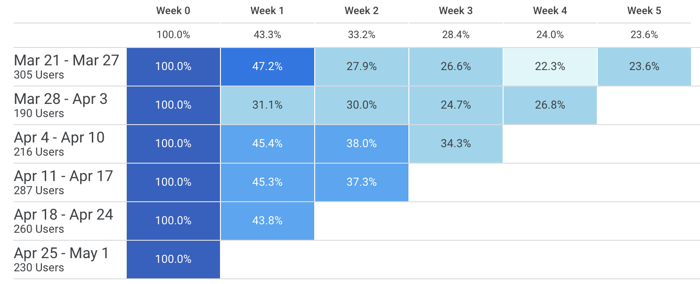
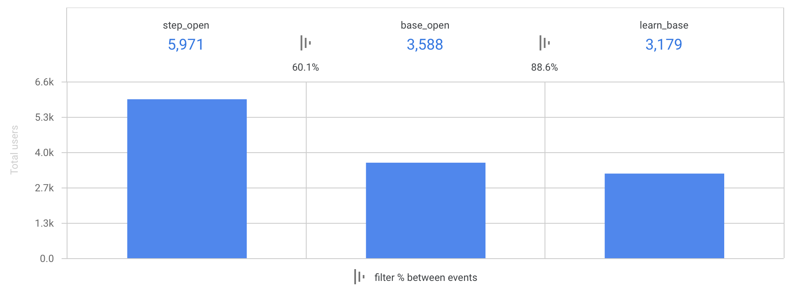

Обычный митинг в продуктовой IT компании в котором принимаю участие программисты, QA и аналитики с маркетологами. Последние часто бросаются какими-то аббревиатурами, объясняя как у нашего продукта идут дела.

**Что это за буквы?** 🤨 Именно такой вопрос возникал у меня на первых неделях работы в продуктовой компании, когда я слышал набор букв типа ROI, ARPU или термины: косты, когорта, лид и т.д. Если у тебя такие же проблемы, то после прочтения данной статьи многое должно проясниться 😉

# Почему это важно? 🤔

В аутсорсе обычный технический специалист редко может слышать о финансовых и маркетинговых метриках, потому что часто этим занимается кто-то со стороны заказчика.

Работая в продуктовой компании, продукт уже не в стороне, ты внутри него и в твоих силах влиять на его состояние гораздо эффективнее чем это происходит в аутсорсе. 

Но куда развивать продукт? Как узнать хорошо ли ему от наших идей и изменений? Ответ на это смогут дать различные показатели, которые мы вместе с тобой рассмотрим далее.

# Немного терминологии 🤓

Рассмотрим основные термины, которые часто употребляются в разговоре с маркетологами, аналитиками и не только :]

🌱 Органика или нет?

Тут речь не о химии, а о разных видах трафика, который делится на органический и неорганический.

**Органический трафик** – это посетители, которые качают приложение или переходят на сайт из обычных результатов поиска, а не платных рекламных объявлений. Высокая позиция в поиске AppStore может здорово поднять твой органический трафик.

**Неорганический трафик** - платный трафик при котором посетители приходят по рекламному объявлению.

**🧲 Customer retention** - это метрика удержания потребителей в течение определенного периода времени. Успех в удержании клиентов измеряется показателем Retention Rate (коэффициент удержания клиентов). Является противоположностью Churn Rate (показатель оттока клиентов). Оценивая Retention Rate можно определить насколько хорошо приложение способно удерживать пользователей.

Пример Retention моего [pet-проекта](https://apps.apple.com/ua/app/medkrok/id1515141600) на котором видно, что если наше приложение установит 300 человек, то спустя месяц им продолжат пользоваться 70 из них (23%)

**🎯 Конверсия** - это процент пользователей, совершивших какое-либо целевое действие.

Небольшой пример расчета конверсии в платеж:

> Конверсия в платеж = Платящие пользователи / Новые пользователи

Т.е. если у нас 100 пользователей и из них 10 совершили покупку, то можно сказать, что конверсия в платеж составляет 10%.

👨‍👩‍👧‍👦 **Когорта** - группа людей, которая имеет одну или несколько общих характеристик и так же совершили определенное действие в заданный отрезок времени.
Например, зарегистрировались в один день или сделали первую покупку в промежутке между 15 и 30 октября. Именно момент времени отличает когорту от обычного сегмента.

🌪 **Funnel (воронка)** - отображает путь пользователя к целевому действию. На каждом этапе прохождения воронки часть пользователей отпадает и только определенный процент доходит до цели (похоже на собеседования с разными этапами отбора 😉).

На данном скрине представлена воронка пользователей, которые шли к изучению предмета в Education приложении. 

Первый этап - пользователи выбирают свой факультет

Второй этап - выбор предмета для изучения

Третий этап - пользователи начали изучать выбранный предмет.

Видно, что практически половина пользователей не дошли до изучения предмета, а потерялись на ранних этапах. Есть над чем подумать, благодаря данной воронке 🤔

**💰 Marketing costs** - совокупность средств, затраченных на маркетинг.

🤑 **Lead** - потенциальный клиент, который ответил на предложение рекламодателя.

🧳 **Gross** — это доход **ДО налогообложения.**

👛 **Net** — это доход **ПОСЛЕ уплаты налогов.**

# Основные метрики 📈

### ROI

ROI (Return of investments) - показатель возврата инвестиций. Вложив куда-то средства, мы можем получить выгоду от этого вложения. Показателем того, как возвращаются вложения, является ROI. Рассчитывается данный показатель за определенный промежуток времени - неделя, год (зависит от бизнеса).

> ROI = (доход - расход) / расход

Если ROI > 0, то можно открывать шампанское 🍾, так как наши инвестиции окупились.

### ARPU

ARPU (Average Revenue Per User) - средний доход от **каждого** пользователя за период времени.

> ARPU = доход за период / количество **активных** пользователей за период

ARPU фокусируется на отрезке времени (месяц, год), а не за все время.

Если за месяц наши 3000 пользователей принесли нам $1000, то имеем:

> ARPU = $1000 / 3000 = $0.3

это означает, что один пользователь нам приносит около $0.3 в месяц.

### ARPPU

ARPU (Average Revenue Per **Paying** User) - средний доход с пользователя, **который заплатил** за ваш продукт или услугу.

> ARPU = доход за период / количество **заплативших** пользователей за период

Главное отличие от ARPU - в ARPPU принимают участие только те пользователи, которые совершили покупку в нашем приложении.

Допустим из наших 3000 пользователей всего 500 являются платниками (совершали покупки), тогда мы можем рассчитать ARPPU:

> ARPPU = $1000 / 500 = $2

Да, именно $2 в среднем приносит платник в этом случае.

### LTV/CLV

LTV/CLV (Lifetime Value / Customer lifetime value) - прибыль, которую приносит пользователь за всё время работы с ним.

> LTV = Lifetime * ARPU

Если наш пользователь находится с нами на протяжении трех месяцев и мы знаем, что его ARPU за месяц составляет $0.3, то можем высчитать LTV:

> LTV = 3 * $0.3 = $0.9

Получается, что один привлеченный пользователь на наш воображаемый проект потенциально может нам принести $0.9. 

Эта метрика помогает определить за сколько мы готовы купить пользователя, закупая трафик. Стоимость привлечения юзера (customer acquisition cost **CAC**) должна быть меньше, чем его LTV, иначе мы получим убытки.

# Заключение 🔑

Мы прошлись по самым распространенным метрикам и терминам, которые используются маркетологами и аналитиками в продуктовой IT компании. Эта информация поможет не просто поддержать беседу с коллегами, а и больше понимать продукт над которым ты работаешь.

# Куда дальше? 🛣

Теперь у тебя достаточно знаний, что бы краем глаза заглянуть в отчеты аналитиков и увидеть как дышит твой проект, сопоставить графики с изменениями на продукте и самостоятельно определить полезность этих изменений.
